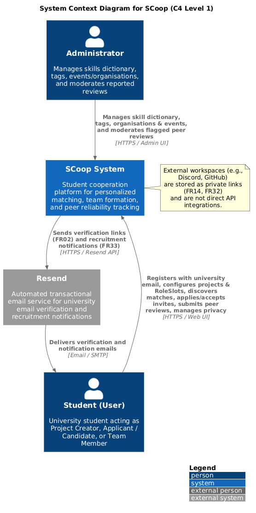
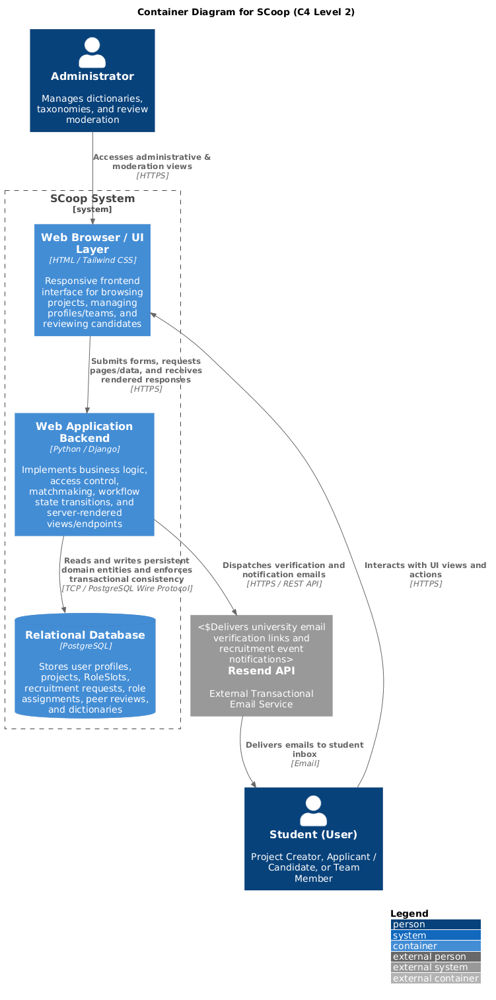
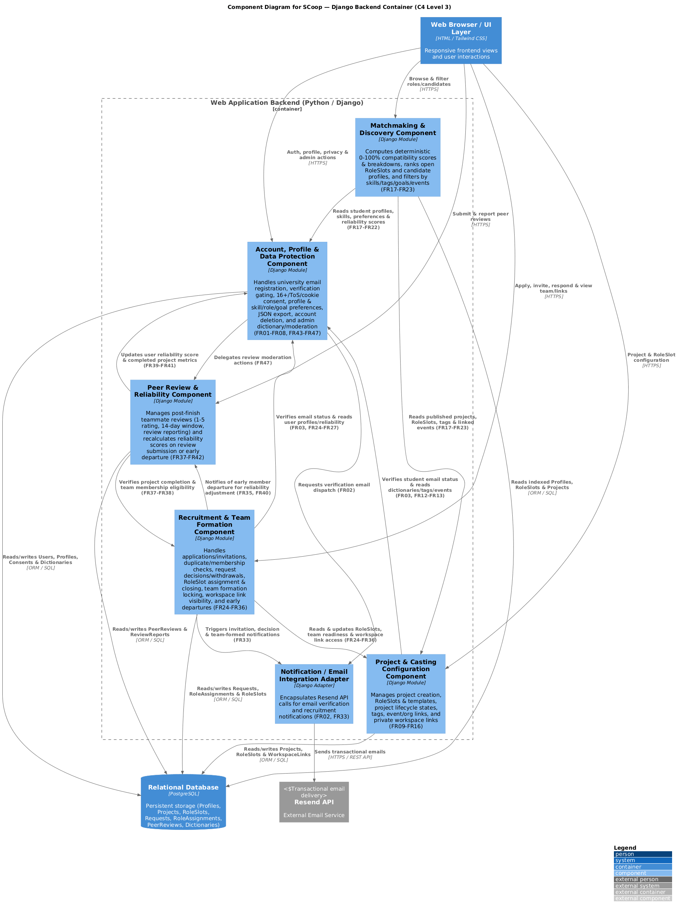

# 3.1 Logical Software Architecture

## Architectural Justification
SCoop is designed as a modular monolith built on **Python / Django** backed by **PostgreSQL**, with a responsive **HTML / Tailwind CSS** frontend and an external transactional email integration via **Resend**. Following the C4 Model (Levels 1–3) keeps the logical architecture focused on responsibilities, domain boundaries, and interaction contracts without binding it to specific cloud providers, instance sizes, load balancers, or deployment topologies.

This structure directly supports SCoop's Stage 2 requirements:
- **Domain modularity (`NFR11`):** Backend components mirror the functional modules and requirement groups (`FR01–FR47`) and Stage 2.3 use case modules, keeping business rules cohesive and testable.
- **Transactional consistency (`NFR03`, `FR29–FR31`, `FR37–FR40`):** Co-locating domain state transitions and reliability recalculations within PostgreSQL transactions prevents race conditions such as double-booking a `RoleSlot` or losing reviews.
- **Responsive matchmaking & interactions (`NFR01`, `NFR02`, `NFR10`):** Centralized access to profiles, `RoleSlots`, and projects supports deterministic compatibility scoring and filtering within latency targets.
- **Privacy & access control (`FR03`, `FR32`, `FR43–FR47`, `NFR07`, `NFR09`):** Explicit boundaries enforce verified student access, GDPR/RODO consent and data export/deletion, and role-gated access to private workspace links and moderation actions.

---

## C4 Level 1 — System Context

### Actors & External Systems
- **Student (User):** Represents university students participating on the platform across the Stage 2.3 roles—**Project Creator**, **Applicant / Candidate**, and **Team Member**. Students register with a university email, maintain profiles and preferences, configure projects and `RoleSlots`, discover matches, manage applications/invitations, submit peer reviews, and exercise GDPR/RODO data controls.
- **Administrator:** Manages platform-wide reference data and governance—specifically the skill dictionary, tags, organisations/events, and moderation of reported peer reviews (`FR47`).
- **SCoop System:** The core software platform providing account/profile management, project and casting setup, deterministic matchmaking, recruitment/team formation, peer reliability tracking, and administrative governance.
- **Resend (External System):** Automated email delivery service used to send university email verification links (`FR02`) and recruitment notifications (`FR33`). External collaboration tools (such as Discord or GitHub) are stored as private links (`FR14`, `FR32`) rather than integrated via external APIs.

---

## C4 Level 2 — Container Diagram

### Containers & Communication
- **Web Browser / UI Layer (`HTML / Tailwind CSS`):** Delivers the responsive user interface across desktop and mobile viewports (`NFR06`, `NFR12`) for students and administrators. Communicates with the backend over **HTTPS**.
- **Web Application Backend (`Python / Django`):** Executes authentication and verification checks, project/casting rules, deterministic matchmaking, recruitment workflows, peer review and reliability score calculations, GDPR/RODO actions, and server-rendered views/endpoints. Communicates with the UI over **HTTPS**, with PostgreSQL over the **PostgreSQL wire protocol**, and with Resend over **HTTPS / REST API**.
- **Relational Database (`PostgreSQL`):** Persists core relational entities—user accounts and profiles, skills/preferences, projects, `RoleSlots`, recruitment requests, role assignments, peer reviews, consent/deletion records, and dictionaries/tags/events.
- **Resend API (External System):** Receives outbound API requests over **HTTPS** from the Django backend and delivers verification and recruitment notification emails to students.

---

## C4 Level 3 — Component Diagram (Django Backend)

### Backend Components & Dependencies
1. **Account, Profile & Data Protection Component (`FR01–FR08`, `FR43–FR47`):**
   - *Responsibilities:* Enforces university email registration (`FR01`), age 16+ / Terms of Service / cookie consent (`FR43`, `FR44`), email verification gating (`FR03`), profile attributes, skill levels, role rankings, weekly availability/location/goal preferences (`FR04–FR08`), JSON data export (`FR45`), account deletion (`FR46`), and admin management of skills, tags, organisations, and events (`FR47`).
   - *Dependencies:* Calls **Notification / Email Integration Adapter** to send verification emails (`FR02`); delegates review moderation to **Peer Review & Reliability Component** (`FR47`); reads/writes account, profile, consent, and dictionary tables in **PostgreSQL**.
2. **Project & Casting Configuration Component (`FR09–FR16`):**
   - *Responsibilities:* Handles project creation, `RoleSlot` definitions and templates, project publication validation (requiring mandatory fields and at least one `RoleSlot`), lifecycle status transitions, project tags, event/organisation links, and private workspace links (`FR09–FR16`).
   - *Dependencies:* Checks verified student status and reads dictionaries/tags/events via **Account, Profile & Data Protection Component** (`FR03`, `FR12–FR13`); reads/writes projects, `RoleSlots`, and workspace links in **PostgreSQL**.
3. **Matchmaking & Discovery Component (`FR17–FR23`):**
   - *Responsibilities:* Calculates deterministic 0–100% compatibility scores and per-criterion breakdowns (skills, role, goal, availability), ranks open `RoleSlots` and candidate profiles, supports multi-criteria filtering, and lists upcoming events with targeted projects (`FR17–FR23`).
   - *Dependencies:* Reads user profiles, skills, preferences, and reliability scores from **Account, Profile & Data Protection Component**; reads published projects, `RoleSlots`, tags, and linked events from **Project & Casting Configuration Component**; queries **PostgreSQL**.
4. **Recruitment & Team Formation Component (`FR24–FR36`):**
   - *Responsibilities:* Processes applications and invitations (`FR24`, `FR25`), prevents duplicate/invalid requests (`FR26`), displays ranked applicants (`FR27`), handles accept/decline/withdraw actions (`FR28`), assigns roles and closes filled/manual `RoleSlots` (`FR29`, `FR30`, `FR36`), marks teams as formed and auto-declines remaining requests (`FR31`), gates workspace links until team formation for members (`FR32`), provides request dashboards (`FR34`), and handles member departures/removals (`FR35`).
   - *Dependencies:* Verifies student email status and reads profile/reliability data via **Account, Profile & Data Protection Component**; updates `RoleSlots`, team status, and workspace link access via **Project & Casting Configuration Component**; calls **Notification / Email Integration Adapter** for notifications (`FR33`); notifies **Peer Review & Reliability Component** on early departure (`FR35`, `FR40`); reads/writes requests, role assignments, and `RoleSlots` in **PostgreSQL**.
5. **Peer Review & Reliability Component (`FR37–FR42`):**
   - *Responsibilities:* Allows team members to submit 1–5 peer reviews with optional comments after a project is finished (within the 14-day window), supports reporting reviews for moderation, displays reliability scores and completed project counts, and recalculates reliability scores upon review submission or early team departure (`FR37–FR42`).
   - *Dependencies:* Updates user reliability scores and project completion counts via **Account, Profile & Data Protection Component** (`FR39–FR41`); checks finished project status and team membership via **Recruitment & Team Formation Component** (`FR37–FR38`); reads/writes reviews and moderation reports in **PostgreSQL**.
6. **Notification / Email Integration Adapter (`FR02`, `FR33`):**
   - *Responsibilities:* Abstracts outbound transactional email formatting and delivery behind an internal interface so domain components do not couple directly to Resend's API payload details.
   - *Dependencies:* Invoked by **Account, Profile & Data Protection Component** (`FR02`) and **Recruitment & Team Formation Component** (`FR33`); calls the external **Resend API** over **HTTPS**.